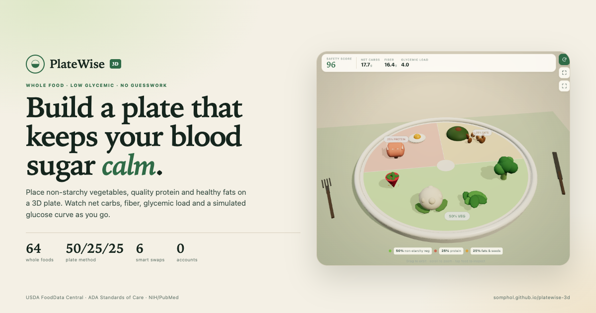

# PlateWise 3D Studio — OpenCode skill

A reusable skill for building **PlateWise 3D**, a release-grade static Three.js
non-starchy whole-food plate picker: 64 whole foods on a 50/25/25 plate,
live net carbs, fiber, glycemic load and a safety score, six starch warnings and
swaps, a simulated glucose curve, a local meal log, three verification layers and
a GitHub Pages release. The pantry covers 30 non-starchy vegetables, 3 berries,
14 proteins and 17 fats, nuts, seeds and oils.



- **Live app:** <https://somphol.github.io/platewise-3d/>
- **App source:** <https://github.com/somphol/platewise-3d>
- **Docs:** <https://somphol.github.io/platewise-3d/docs/>

## Install the skill

```jsonc title="opencode.jsonc"
{
  "$schema": "https://opencode.ai/config.json",
  "skills": ["https://somphol.github.io/platewise-3d-skill/"]
}
```

Then ask for a “PlateWise-style 3D non-starchy food picker” or load
`@platewise-3d-studio`.

## Use it locally

```sh
node ~/.config/opencode/skills/platewise-3d-studio/scripts/new-project.mjs \
  --out ~/Projects/my-platewise
cd ~/Projects/my-platewise
python3 -m http.server 8000
node --test tests/static.test.mjs
node tests/browser.test.mjs
```

The reference is complete: no npm install, no build. It ships its own screenshots,
docs and `state.json` as provenance. Replace the URLs and content, then re-capture
the build state for your own session.

## What is inside

```text
platewise-3d-studio/
├── SKILL.md                  # when to use, workflow, recipes, limits
├── ATTRIBUTION.md
├── LICENSE                   # MIT
├── assets/reference/         # the complete app, docs, tests, screenshots
├── references/
│   ├── method.md             # construction order and invariants
│   ├── nutrition-model.md    # every formula and serving
│   ├── three-scene.md        # camera, zones, slots, food factories
│   ├── verification.md       # 22 static + 47 browser + 29 in-page checks
│   ├── lessons.md            # the regressions that actually happened
│   ├── hosting.md            # Pages, catalog, keychain-safe pushes
│   └── build-log.md          # the reference build narrative
└── scripts/
    ├── new-project.mjs       # scaffolds a clean copy
    └── verify-skill.mjs      # proves the shipped reference still passes
```

## Verify the shipped reference

```sh
node platewise-3d-studio/scripts/verify-skill.mjs            # 22 static
node platewise-3d-studio/scripts/verify-skill.mjs --browser  # + 47 browser
```

The browser suite uses one headless Chrome with `--use-mock-keychain` and a
throwaway profile. It needs network access for the pinned Three.js 0.169.0 CDN.

## The product boundary

PlateWise is an educational visualizer, not a medical device. It does not
diagnose, treat or predict an individual's glucose. The curve is a deterministic
teaching model, not a CGM. Starchy and ultra-processed foods are never placeable;
the warning modal redirects to a whole-food swap. Keep those constraints.

## Catalog

The catalog is served at <https://somphol.github.io/platewise-3d-skill/>. It lists
this skill and a content-hash version in `index.json`. The version changes
automatically via `node scripts/sync-index.mjs`.

## Credits

- Concept, reference app and skill: Somphol Boonjing
- Built with [OpenCode](https://opencode.ai), DeepSeek V4.1 Flash
- Three.js 0.169.0 (MIT)
- Nutrition evidence: USDA FoodData Central, ADA Standards of Care, NIH/PubMed,
  international GI tables

MIT. See [LICENSE](LICENSE) and [ATTRIBUTION.md](ATTRIBUTION.md).
