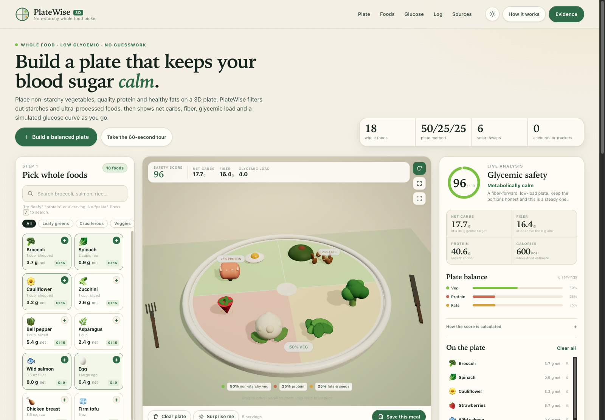
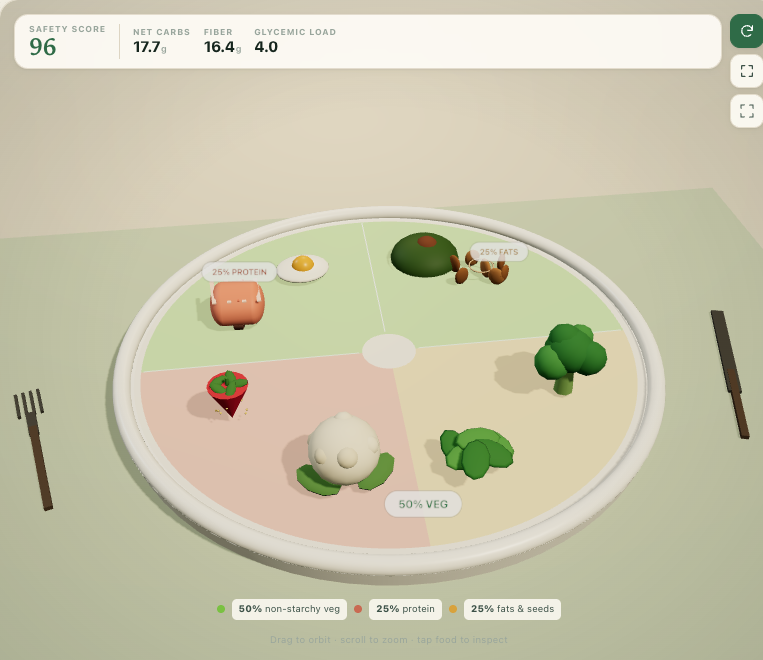
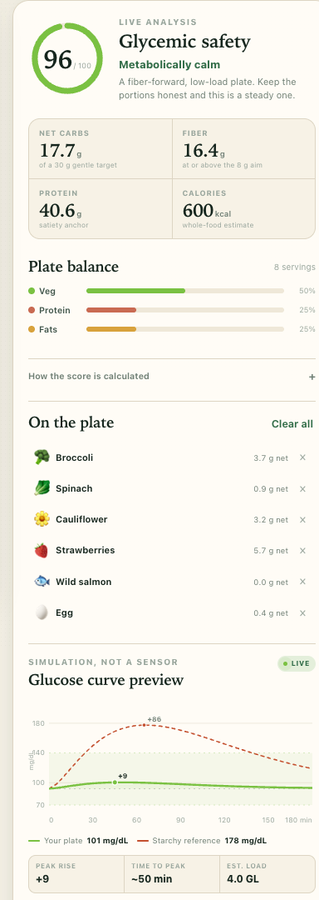
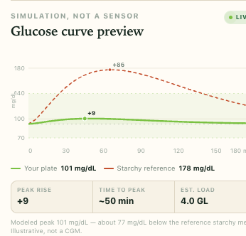
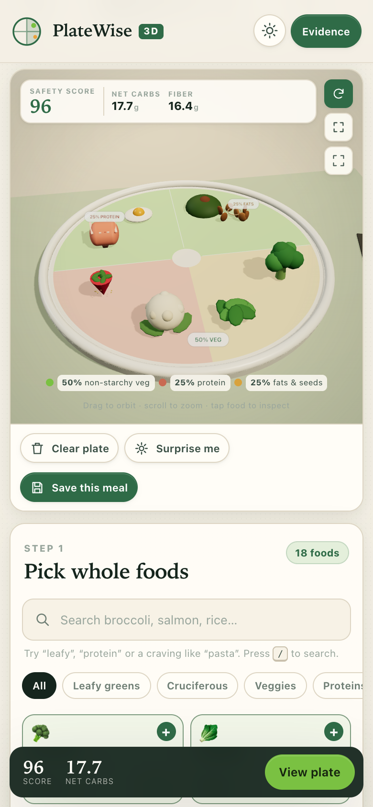

# PlateWise 3D

**Non-starchy whole food picker.** Build a dinner plate in 3D, watch net carbs, fiber, glycemic load and a simulated glucose curve update with every whole food you place — and get a gentle, evidence-grounded redirect when a craving would spike.

[**Open the live app →**](https://somphol.github.io/platewise-3d/)

[](#quick-start)
[](https://threejs.org/)
[](#verification)
[](LICENSE)



## Why it exists

People managing diabetes or insulin resistance are often told to “eat healthy” and handed a list of foods to avoid. The useful question is the opposite: **what can I put on this plate right now?**

PlateWise answers that with a constrained, whole-food pantry. Potatoes, corn, rice, wheat, pasta and ultra-processed snacks are deliberately excluded. What remains is non-starchy vegetables, quality protein, healthy fats and low-GI berries — arranged on a 50/25/25 plate, with the numbers shown honestly and the caveats kept visible.

It is an educational visualizer, **not a medical device or a CGM**.

## What you can do

- **Build a 3D plate.** Orbit, zoom and pan a procedural ceramic plate divided into 50% non-starchy veg, 25% protein and 25% healthy fats.
- **Place 18 whole foods.** Broccoli, spinach, cauliflower, zucchini, peppers, asparagus, wild salmon, eggs, chicken, tofu, avocado, almonds, walnuts, olive oil, chia, strawberries, raspberries and blueberries. Each is a hand-built Three.js mesh.
- **See the load immediately.** Net carbs, fiber, protein, calories, glycemic load and a 0–100 Glycemic Safety Score update on every placement. The score rewards fiber, protein and vegetable share, and subtracts glycemic load and net-carb density.
- **Get warned, not shamed.** Tap white rice, potato, fries, white bread, pasta or sugary cereal and a modal explains the spike risk with its GI, GL and net carbs — then offers a whole-food swap.
- **Swap the craving.** Rice → cauliflower rice. Pasta → zucchini noodles. Mashed potato → mashed cauliflower. Bread → almond–chia cloud bread. Sugary snacks → walnuts and berries. Fries → roasted asparagus.
- **Preview the curve.** A 180-minute modeled glucose curve compares your plate with a reference rice-and-potato meal. It is a teaching model with a visible “not a sensor” label, not a prediction about you.
- **Save what worked.** Meals are stored in `localStorage`, reloadable in one tap, exportable as JSON, and never uploaded.
- **Use it your way.** Light and dark themes, keyboard shortcuts, a built-in self-test, responsive layout down to 390 px, reduced-motion support and no accounts.

| The plate | The analysis | The curve |
| --- | --- | --- |
|  |  |  |

<p align="center">
  
  <br>
  <em>The same plate, score and pantry at 390 px, with the live mobile dock.</em>
</p>

## Quick start

No build, no package manager, no backend. Serve the repository root and open it:

```sh
cd platewise-3d
python3 -m http.server 8000
# http://localhost:8000/
```

An internet connection is required on first load for the pinned Three.js 0.169.0 CDN module (and OrbitControls from the matching path). There are no other network requests in the app.

To deploy, push to `main` with GitHub Pages set to **Deploy from a branch → main → / (root)**. See [`docs/DEPLOYMENT.md`](docs/DEPLOYMENT.md).

## Project structure

```text
.
├── index.html              # all UI, dialogs, import map, SEO metadata
├── style.css               # design system, responsive layout, light/dark themes
├── script.js               # data, nutrition engine, Three.js scene, UI, self-test
├── assets/                 # favicon, screenshots, social card
├── docs/                   # architecture, nutrition, sources, testing, reproduction
├── tests/
│   ├── static.test.mjs     # repository and release invariants
│   ├── browser.test.mjs    # 47 end-to-end checks in headless Chrome
│   └── lib/harness.mjs     # dependency-free static server + CDP harness
├── scripts/
│   ├── smoke.mjs           # quick boot + console-error check
│   ├── screenshot.mjs      # regenerates README images
│   └── og-card.html        # 1200 × 630 social card source
├── state.json              # build time, token usage, verification and credits
├── AGENTS.md               # handoff for the next agent
└── .github/workflows/ci.yml
```

The application is intentionally three files. There is no framework, bundler, runtime npm dependency or generated CSS.

## The model in one screen

**Net carbs** = total carbohydrate − dietary fiber, per stated serving. Values come from USDA FoodData Central per-100 g records and are scaled by the serving weight in the app.

**Glycemic load** = GI × net carbs ÷ 100. GI values are typical published values from international tables; they are population approximations, not personal measurements.

**Glycemic Safety Score** (0–100):

```text
96 − 1.7·GL − 0.45·netCarbs + min(8, 0.55·fiber)
   + min(6, 0.08·protein) + 8·vegShare
```

clamped to 0–100 and rounded. An incomplete plate is labelled **“Plate needs balance”** even if its glycemic numbers are low.

**Curve**: baseline 92 mg/dL; rise = clamp(3 + GL·2.05, 3, 96) × a fiber brake; time-to-peak = 34 + min(34, netCarbs·0.9) minutes; a gamma-shaped response returns toward baseline by 180 minutes. The starchy reference is a fixed GL-46, 5 g-fiber meal. Full formulas and worked examples are in [`docs/NUTRITION.md`](docs/NUTRITION.md).

## Evidence

Nutrition numbers are derived from **USDA FoodData Central**. The plate method and carbohydrate-aware framing follow the **American Diabetes Association Standards of Care** and the 2019 nutrition consensus report. Glycemic index values are from the 2021 international tables. Carbohydrate-restriction research is cited for context, not as a promise.

- [Nutrition methodology](docs/NUTRITION.md)
- [Full source list with links](docs/SOURCES.md)

The app also carries an in-product Evidence dialog and a medical disclaimer. Nothing here is medical advice.

## Verification

```sh
node --test tests/static.test.mjs     # repository and release invariants
node tests/browser.test.mjs           # 47 end-to-end checks in headless Chrome
node scripts/smoke.mjs                # fast boot + console-error check
```

The browser harness launches one headless Chrome with `--use-mock-keychain`, `--password-store=basic` and a throwaway profile, so macOS does not produce Keychain prompts. It needs Chrome and network access to the pinned CDN.

For the live deployment:

```sh
TEST_URL=https://somphol.github.io/platewise-3d/ node tests/browser.test.mjs
```

The in-page suite is available at [`/?selftest`](https://somphol.github.io/platewise-3d/?selftest) — 29 checks covering data integrity, food factories, storage, the score bounds, the curve and WebGL.

Details: [`docs/TESTING.md`](docs/TESTING.md).

## Privacy

No accounts, cookies, analytics, error reporting, fonts, trackers or backend. Meals and theme preferences live in this browser's `localStorage`; the export button writes a JSON file locally. Three.js is the only third-party runtime request. See [`docs/PRIVACY.md`](docs/PRIVACY.md).

## Accessibility

Semantic landmarks, a skip link, labelled dialogs, keyboard-operable food placement and plate management, a live announcer, visible focus rings, reduced-motion handling and a 390 px layout. The 3D canvas is decorative-plus-interactive; all essential actions are duplicated in DOM controls. See [`docs/ACCESSIBILITY.md`](docs/ACCESSIBILITY.md).

## Credits

- **Concept, build and release:** Somphol Boonjing
- **Built with [OpenCode](https://opencode.ai)**
- **Model:** DeepSeek V4.1 Flash (`opencode-go/deepseek-v4.1-flash`)
- **3D:** [Three.js](https://threejs.org/) 0.169.0, MIT
- **Nutrition evidence:** ADA, USDA FoodData Central, NIH/PubMed, international GI tables — cited, not bundled

The build's wall-clock time, token usage and verification totals are recorded honestly in [`state.json`](state.json), read from the OpenCode session database.

## License

MIT © 2026 Somphol Boonjing. See [LICENSE](LICENSE) and [THIRD_PARTY_NOTICES.md](THIRD_PARTY_NOTICES.md).

**Not medical advice.** Glycemic responses vary with medication, activity, sleep, portion size, preparation and individual biology. Talk to your clinician or a registered dietitian before changing treatment.
